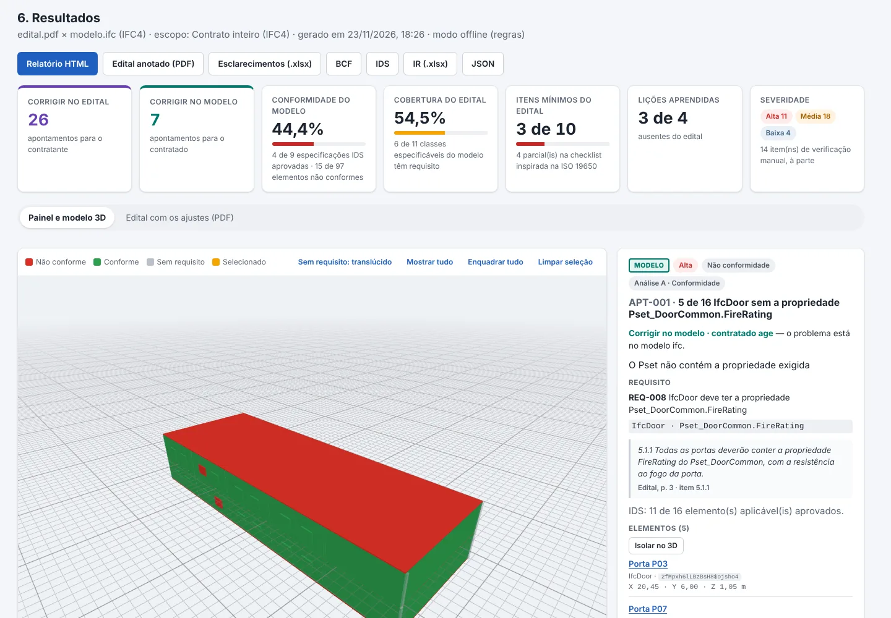

# EditalCheck

**Verificador bidirecional Edital × IFC.** O EditalCheck lê um edital em PDF e transforma as exigências dele em requisitos de informação (IR) e num arquivo IDS. Depois, confere o modelo IFC contra esses requisitos e aponta o que corrigir no edital e no modelo.



## O que ele responde

1. **O modelo cumpre o edital?** Os requisitos do edital viram um IDS, gerado por código, e o modelo IFC é validado contra ele.
2. **O edital está bom?** O sistema aponta termos vagos, itens mínimos ausentes, contradições e lições aprendidas que o edital não cobre.
3. **O edital cobre o modelo?** O sistema mede quanto do modelo o edital especifica e sugere requisitos para as lacunas.

Cada apontamento diz onde está o problema, o que fazer e quem corrige: o contratante (no edital) ou o contratado (no modelo). Os resultados saem num relatório HTML, num BCF, num edital anotado em PDF e numa planilha dos IR.

## Rodar localmente

Precisa só do [Docker](https://docs.docker.com/get-docker/).

```bash
docker compose -f docker-compose.local.yml up --build
```

Abra **http://localhost:8000** e clique em **Usar dados de exemplo**.

Sem configuração, o sistema roda com regras determinísticas. Para usar a IA (Google Gemini), copie `.env.example` para `.env`, preencha `GEMINI_API_KEY` e suba de novo.

> Os arquivos enviados ficam só na memória. Parar o contêiner apaga tudo.

## Documentação

| Documento | Conteúdo |
|---|---|
| [Visão geral](docs/visao-geral.md) | Fluxos, funcionalidades e padrões Open BIM (IFC, IDS, BCF, bSDD) |
| [Desenvolvimento](docs/desenvolvimento.md) | Rodar sem Docker, CLI, testes e CI |
| [Deploy em produção](docs/deploy.md) | Imagem, proxy reverso, variáveis e segurança do contêiner |
| [Arquitetura](docs/arquitetura.md) | Arquitetura hexagonal e salvaguardas contra alucinação |
| [Dados e segurança](docs/dados-e-seguranca.md) | LGPD, tratamento de dados e segurança da aplicação |
| [Contrato da API](docs/api.md) | Rotas, formatos e erros |
| [Todos os documentos](docs/README.md) | Métricas da demonstração, limites, licenças e histórico |

## Tecnologias

Python 3.12 · FastAPI · IfcOpenShell · ifctester · PyMuPDF · Google Gemini · TypeScript · Vite · That Open Components · pdf.js

---

Criado no Hackathon Open BIM + IA (Sinaenco, 22–23/11/2026). Licenças das dependências em [Limites e licenças](docs/limites-e-licencas.md).
